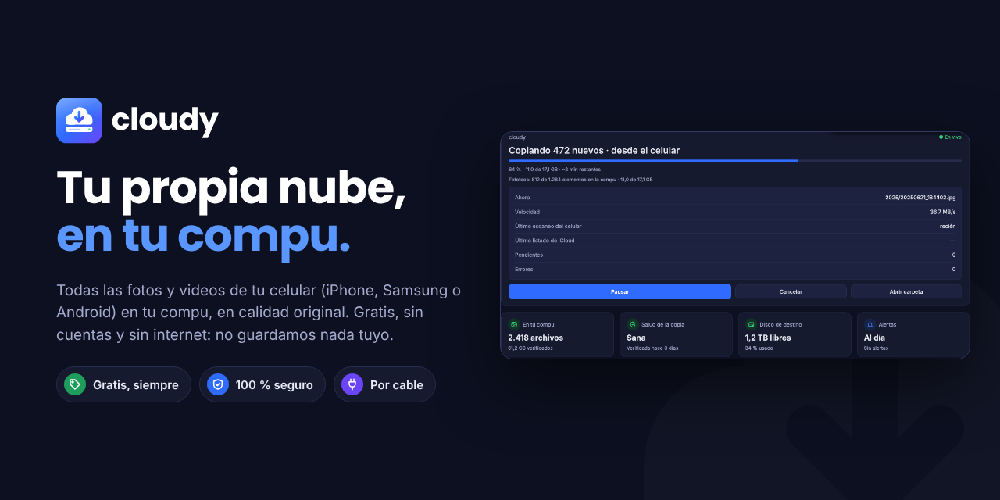

<p align="center">
  
</p>

<h1 align="center">Cloudy</h1>

<p align="center">
  <b>Tu propia nube, en tu compu.</b><br>
  Pasá todas las fotos y videos del celular (iPhone, Samsung o cualquier Android) a tu computadora, en calidad original.<br>
  Gratis, siempre. Por cable, sin cuentas y sin servidores: no guardamos nada tuyo.
</p>

<p align="center">
  
  
  
  
</p>

---

Cloudy (antes «iPhone Vault») copia **todas** tus fotos y videos a tu compu en calidad original, verificados uno por
uno y sin cortes. Funciona **por cable** con iPhone, Samsung y cualquier Android, con **tarjetas SD, cámaras y pendrives**, y, si querés,
también **desde iCloud Fotos**. Corre en Windows y macOS.

### ¿Por qué es seguro?

- **Sin internet:** por cable, la app bloquea cualquier conexión que no sea la del celular. Con iCloud (opcional), solo
  puede hablar con servidores de Apple.
- **Solo lectura:** del celular, la tarjeta o la cámara solo se lee. No hay ni una función para borrar o modificar nada.
- **Sin cuentas:** no te registrás en nada.
- **No guardamos nada:** no hay servidores de Cloudy ni estadísticas de uso. Tus fotos y tus datos quedan solo en la
  carpeta que elijas. La contraseña de Apple nunca se guarda.
- **Código abierto:** cualquiera puede revisar qué hace, línea por línea.

## Qué hace

| | |
|---|---|
| **Todos los originales** | Fotos, videos y Live Photos (con su video), en el formato original (HEIC, HEVC, ProRAW…), ordenados en una carpeta por año (2024, 2025…). La fecha de captura queda como fecha de creación y modificación del archivo, y los metadatos (EXIF: fecha, cámara, ubicación) siguen dentro de cada foto: no se generan .json. |
| **iPhone, Samsung y todo Android** | Detecta solo lo que enchufes. Android por **MTP** («Transferencia de archivos», Windows, sin instalar nada) o por **ADB** (Windows/Mac, con «Depuración USB»: además compara el SHA-256 calculado **en el propio celular**). Copia la cámara, capturas, Pictures/Movies, la tarjeta SD del celular y, si querés, lo recibido por WhatsApp y Telegram. Saltea papelera, miniaturas y fotos enviadas (copias comprimidas). |
| **Tarjetas SD, cámaras, pendrives** | «Tarjeta SD o carpeta…» copia cualquier carpeta (incluye RAW: ARW, CR3, NEF, DNG…), sin seguir accesos directos que salgan de ella y sin leer nunca tu carpeta destino. |
| **Verificación de cada archivo** | Tamaño exacto, SHA-256 (se relee del disco y se compara) y estructura del archivo (HEIC/MOV/JPEG/PNG). |
| **Nunca pierde el hilo** | Si se desenchufa el cable, se corta internet, se reinicia la PC o vence un enlace de iCloud, espera y **sigue desde el mismo byte**. |
| **Pausar / reanudar** | En cualquier momento, sin perder nada. |
| **Estimado de tiempo** | Porcentaje, GB copiados de GB totales, velocidad y tiempo restante en vivo. |
| **Resincroniza** | Solo copia lo nuevo. Puede copiar sola al enchufar el iPhone y revisar iCloud cada N horas. |
| **Detecta optimizadas** | Las fotos que en el iPhone están «optimizadas» van a **Pendientes**. Se bajan desde iCloud en calidad original, o desde el iPhone cuando las descargue. |
| **Liberar espacio** | Manda a «Eliminado recientemente» de iCloud **solo lo pesado** (tamaño, solo videos, antigüedad) y **solo lo verificado en la PC**. Trabaja por tandas y es recuperable durante 30 días. |
| **Ver todo en Windows** | El lanzador instala gratis los códecs oficiales de Microsoft (HEIF y HEVC «from Device Manufacturer»). Así los originales se abren sin convertir nada. Si no hay Microsoft Store, instala ImageGlass y VLC. También existe la opción de crear copias JPG/MP4. |
| **Copias espejo** | Replica cada archivo verificado en un NAS, un disco externo o la carpeta de OneDrive, Google Drive o Dropbox. |
| **Menú contextual** | Clic derecho en la Fototeca: abrir, mostrar en la carpeta, copiar ruta, copiar solo ese, excluir. |
| **Privacidad** | Por cable no usa internet: la app bloquea toda conexión que no sea a usbmuxd (incluye UDP, sockets crudos y proxies locales). Con iCloud, solo permite servidores de Apple. La contraseña de Apple nunca se guarda. No hay servidores de terceros. |
| **Salud de tu copia** | Página «Salud»: relee cada archivo del disco y lo compara con su SHA-256 original (detecta archivos borrados, cambiados o dañados por el disco). «Reparar» los vuelve a traer en la próxima copia sin repetir nada. Recordatorio cada 30 días (configurable). |
| **Catálogo a prueba de cortes** | El catálogo (`.vault/manifest.db`) se respalda solo después de cada copia y verificación (se guardan 7). Si se daña, al abrir se restaura el último respaldo sano. |
| **Alertas** | Avisos flotantes con el mismo diseño de la app, centro de alertas con historial y avisos de Windows cuando la app está minimizada. Todas las ventanas de confirmación son propias (nada de ventanas grises). |
| **Cuida el disco y la PC** | Avisa si queda poco espacio, frena antes de llenar el disco y detecta FAT32 (no acepta archivos de más de 4 GB). La PC no se suspende mientras copia o verifica. |
| **Registro sin datos personales** | Se guarda en disco (rota a 1 MB × 5) con correos, códigos y tokens enmascarados; se puede exportar en .zip. |
| **Probada bajo estrés** | 22 pruebas de estrés: 30.000 elementos, cortes de cable, kill -9, disco lleno, orígenes hostiles, intentos de fuga de red. Ver `stress/INFORME.md`. |

## Instalar y abrir

**Windows**
1. Instalá Python 3.10 o superior desde python.org (marcá «Add python.exe to PATH»).
2. Doble clic en **`Iniciar Cloudy.bat`**. Si tenés iPhone, instala solo el driver USB de Apple. Para Android no hace
   falta nada más.

**macOS**
1. Instalá Python 3 desde python.org.
2. Doble clic en **`Iniciar Cloudy (Mac).command`**. Si macOS lo bloquea: clic derecho > Abrir.
3. Para Android en Mac hace falta ADB (herramientas oficiales de Google): la app te ofrece instalarlo con Homebrew.

La primera vez aparece una guía corta (carpeta, cable, «Confiar en esta computadora»). La primera vez instala las dependencias en la carpeta `.venv` (tarda unos minutos).

## Probar sin celular

En **Ajustes**, activá «Modo demo». Simula un iPhone, un Samsung Galaxy (con cámara, capturas, WhatsApp, Telegram,
tarjeta SD, papelera y miniaturas) y un iCloud con fotos, videos, Live Photos, una edición, una captura y 3 fotos
«optimizadas». Para iCloud demo, usá cualquier contraseña y el código **123456**.
También hay botones para simular un **corte de cable** (vas a ver que retoma solo) y para simular que el iPhone
ya descargó los originales.

## Usarlo con tu celular

1. Elegí la **carpeta destino** en Inicio.
2. Enchufá el celular, desbloquealo y tocá **Conectar celular**.
   - **iPhone:** la primera vez, tocá **Confiar** en el teléfono.
   - **Samsung / Android:** en el aviso «USB» de las notificaciones elegí **Transferencia de archivos**. En Mac (o para
     la verificación extra en el celular), activá **Opciones de desarrollador › Depuración USB** y aceptá el permiso.
   - **Tarjeta SD, cámara o pendrive:** tocá **Tarjeta SD o carpeta…** y elegila.
3. **iCloud (opcional):** tocá **Conectar iCloud**, ingresá tu Apple ID y el código de 2 pasos.
   Apple pide que esté activado «Acceso a los datos de iCloud en la web» y desactivada la «Protección de datos avanzada».
4. Revisá **Ajustes**: el máximo por copia arranca en **10** para probar.
5. Tocá **Copiar ahora**. Primero copia del iPhone y después baja de iCloud lo que falte. Nunca duplica.

## Liberar espacio en iCloud: reglas de seguridad

Un elemento solo se borra si cumple todo esto:
1. Su copia local existe y figura como verificada.
2. El tamaño local es **idéntico** al del original de iCloud. Nunca se borra algo del que solo tengas una versión optimizada.
3. Justo antes de borrarlo, se vuelve a calcular su SHA-256 y coincide con el registrado.
4. Va a «Eliminado recientemente», no se borra definitivamente.
5. Para confirmar, hay que escribir BORRAR.

**Nada se borra nunca del celular, la tarjeta ni la cámara.**

## Diagnóstico

`Diagnostico.bat` (o `Diagnostico (Mac).command`) genera `diagnostico_cloudy.json` (en tu compu), que solo contiene cantidades.
Para Android: `python -m iphone_vault diagnose --source android`. Si algo no te cierra con tu celular real, compartilo.

## Para desarrolladores

```
set PYTHONPATH=src          (macOS: export PYTHONPATH=src)
python -m iphone_vault                      # interfaz
python -m iphone_vault diagnose [--demo] [--source auto|iphone|android|android-adb|android-mtp|carpeta]
python -m iphone_vault transfer --dest D:\Fotos --limit 10 [--pending] [--demo] [--source …] [--folder E:\]
python -m pytest -q                         # pruebas del flujo completo (incluye un ADB falso que ejecuta de verdad)
python stress/run_stress.py                 # 22 pruebas de estrés (~4 min) → stress/INFORME.md
```

```
src/iphone_vault/
  device/     iphone.py (USB, pymobiledevice3) · icloud.py (pyicloud) · demo.py · icloud_demo.py · base.py
              adb.py (Android por ADB) · mtp_windows.py (Android/cámaras por MTP) · folder.py (SD, cámaras)
              android_common.py · android_demo.py · detect.py (qué hay enchufado)
  scanner/    media_scanner.py · photos_db.py (Photos.sqlite: detecta optimizadas) · generic_scanner.py (Android)
  catalog/    manifest.py (SQLite en <destino>/.vault: copiados, pendientes, espejos, borrados)
  transfer/   engine.py (copia, reanudación, reconexión, pausa, ETA) · validate.py (estructura) · cleanup.py
  security/   no_network.py (solo local; con iCloud, solo Apple) · logs.py (registro sin datos personales)
  system/     power.py (no suspender) · disk.py (espacio y formato del disco)
  ui/gui/     main_window.py · dialogs.py · toasts.py · alerts.py · onboarding.py · brand.py · theme.py
```

## Limitaciones conocidas

- iPhone: los archivos de otras apps (WhatsApp, app Archivos) todavía no están incluidos.
- Android: la carpeta segura de Samsung («Carpeta segura») y las fotos solo en Google Fotos / OneDrive no se ven por
  cable. Los álbumes de la Galería no viajan en los archivos (las fotos sí).
- Android por MTP: Windows a veces tarda unos minutos en mostrar fotos recién sacadas; volvé a escanear.
- iCloud no funciona con «Protección de datos avanzada» activada ni con llaves de seguridad físicas.
- La detección de fotos optimizadas por cable depende del esquema de Fotos de iOS. Si con tu iOS da números raros, usá el diagnóstico.

## Licencia

[MIT](LICENSE): podés usar, copiar y modificar Cloudy libremente, siempre que mantengas el aviso de copyright.

Cloudy no está afiliado a Apple, Samsung ni Google. iPhone e iCloud son marcas de Apple Inc.; Galaxy es marca de
Samsung; Android es marca de Google LLC.
